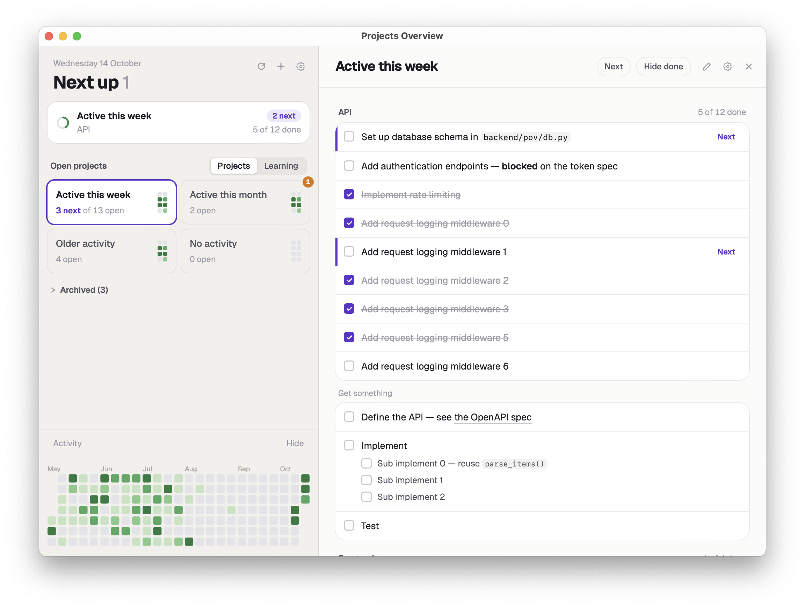

# Projects Overview (pov)

A macOS desktop app for tracking TODO.md files across projects. Built with Tauri, a React frontend and a Rust core (`src-tauri/core/`), which also provides the `pov` CLI.

Can be fed by external tools via MCP, and can delegate tasks to local agents.



## Prerequisites

- [Rust](https://rustup.rs/)
- [Node.js](https://nodejs.org/) (v18+)

## Development

Install dependencies:

```sh
npm install
```

Run the app in dev mode (hot-reloading frontend):

```sh
npm run tauri dev
```

Dev builds use `~/.local/share/pov-dev/` for data, keeping it separate from production data.

Build the dev CLI (used by **Settings → Install CLI** in dev mode, which symlinks it):

```sh
cd src-tauri && cargo build -p pov-core --features cli --bin pov-cli
```

## Testing

UI feature tests use Vitest + React Testing Library. They render the real frontend and run
the real Rust commands through a test-only HTTP bridge (`pov-bridge`) on a temp `HOME`, faking
only native calls (file dialog, editor, CLI install):

```sh
npm test
```

Rust core and CLI tests, against real SQLite and files in a temp dir (no mocks):

```sh
cd src-tauri && cargo test -p pov-core --all-features
```

A launch smoke test starts the real debug app on a temp `HOME` and checks the Rust startup and
file watcher (a window appears while it runs):

```sh
npm run smoke
```

## Build

Build the app:

```sh
npm run tauri build
```

The output is a `.dmg` at `src-tauri/target/release/bundle/dmg/`.

`beforeBuildCommand` also runs `scripts/build-cli.sh`, which builds the release `pov-cli` and copies it to `src-tauri/binaries/` (gitignored) for bundling.

## Gatekeeper (first launch)

The app is unsigned. macOS blocks unsigned apps on first open. Fix with:

```sh
xattr -d com.apple.quarantine "/Applications/Projects Overview.app"
```

Or: right-click the `.app` in Finder → Open → click Open in the dialog.

## CLI

The app ships a `pov` CLI. Install it from **Settings → Install CLI** inside the app. It gets copied to `~/.local/bin/pov` — make sure that's on your `PATH`.

```sh
pov add path/to/TODO.md           # track a project
pov add path/to/TODO.md --type learning
pov list                          # list tracked projects
pov remove "project name"         # stop tracking
pov import-time "Maths" TIME.md   # import a time log into a project
pov mcp                           # MCP server for Claude Code (see below)
```

`import-time` reads a markdown table of `| DATE | TIME | TOPIC |` rows, where
TIME is a number of hours (comma or dot separator), and records the entries
against the project's time heatmap. If the project already has time entries it
refuses to run, unless given `--append` (keep them) or `--replace` (drop them).

### Claude Code and other MCP clients

`pov mcp` is an MCP server on stdio: it lets Claude Code add tasks to your projects. Added tasks
land in the project's inbox, for you to keep, mark next or delete in the app. The app doesn't
need to be running.

```sh
claude mcp add --scope user pov -- ~/.local/bin/pov mcp
```

The shell expands `~` to an absolute path, which the client needs: GUI clients don't get your
shell's `PATH`. `--scope user` makes it available in every project.

Other clients take a JSON config; use the absolute path:

```json
{
  "mcpServers": {
    "pov": { "command": "/Users/<you>/.local/bin/pov", "args": ["mcp"] }
  }
}
```

Tools: `list_projects`, `list_sections` (a project's headings), `add_task` (project, text,
optional section, stage and metadata). Agents answer delegated tasks with `list_delegated`,
`add_subtask`, `add_links` and `finish_task` (see below). For development, register
`src-tauri/target/debug/pov-cli mcp` instead: a debug build uses the dev data dir.

## Delegating tasks to agents

A task can be handed to a local agent (an LLM pipeline, a script) that works on it and reports
back: subtasks, links to what it made, then the task returns to your inbox for review.

### Setup

1. **Settings → Tools**: add the agent: a name, the URL pov sends tasks to (`http://` only), and
   optionally the command that starts it when nothing answers there. The command is an absolute
   path: the app has no shell `PATH`.
2. **Project settings**: tick the tools the project can delegate to.
3. Hover a task → **Delegate** (a menu when the project has several tools) → optional note →
   **Delegate**. The task turns teal with the tool's name and has no actions until the agent
   sends it back; **Delegated** filters the task pane to these.

Tools are stored in `config.json` in the data dir, which can also be edited by hand:

```json
{
  "projects": [{ "id": "…", "name": "Writing", "path": "…/TODO.md", "tools": ["writer"] }],
  "tools": {
    "writer": { "url": "http://127.0.0.1:8765/tasks", "command": "/Users/<you>/bin/writer-agent" }
  }
}
```

### Agent contract

1. **pov sends the task**: `POST <url>` with `Content-Type: application/json`:

   ```json
   {
     "id": 12,
     "project_id": "…",
     "project_name": "Writing",
     "text": "Draft the quarterly report",
     "subtasks": [{ "hash": "…", "text": "…", "checked": false, "line_number": 4 }],
     "data": { "note": "Use last quarter's figures", "links": [], "source": {} }
   }
   ```

   `id` is the task's handle for every call back; `data` is the task's metadata (the note typed
   when delegating, links, and whatever the tool that added the task stored, e.g. `source`).
2. **The agent takes it** by answering any `2xx` within 10 s, then works in the background.
   Anything else, or no answer, leaves the task as it was and pov shows the error.
3. **If nothing answers**, pov runs the start command (detached, no stdio, one instance per tool
   while pov runs), waits up to 10 s for the URL, then sends.
4. **The agent answers through `pov mcp`**, by `id`:
   - `add_subtask(id, text, checked = true)`: a line under the task; Markdown links in `text`
     open on click.
   - `add_links(id, links)`: `[{ "label", "target", "app"? }]` in the task's details (ⓘ). A
     target is a URL or a file path; `app` names the app to open it with (`open -a`), e.g.
     `"LibreOffice"`, else the default app. Never a shell command.
   - `finish_task(id)`: the task leaves the agent and lands in the inbox. On failure, add an open
     subtask saying why, then finish.
   - `list_delegated(tool)`: the agent's tasks, to catch up after a restart.

The app shows an agent's answers when its window gains focus.

### Try it

`scripts/fake-agent` takes each task, adds a checked subtask and a link to the Calculator, and
finishes it after 3 s (logs to `/tmp/fake-agent.log`). Add it in Settings with URL
`http://127.0.0.1:8765/tasks` and its absolute path as the start command.

## Data locations

| Mode | Path |
|------|------|
| Production | `~/.local/share/pov/` |
| Dev | `~/.local/share/pov-dev/` |

Each directory contains a SQLite database (`pov.db`), `config.json` (projects and tools) and a git-tracked folder of hardlinked TODO.md files.
